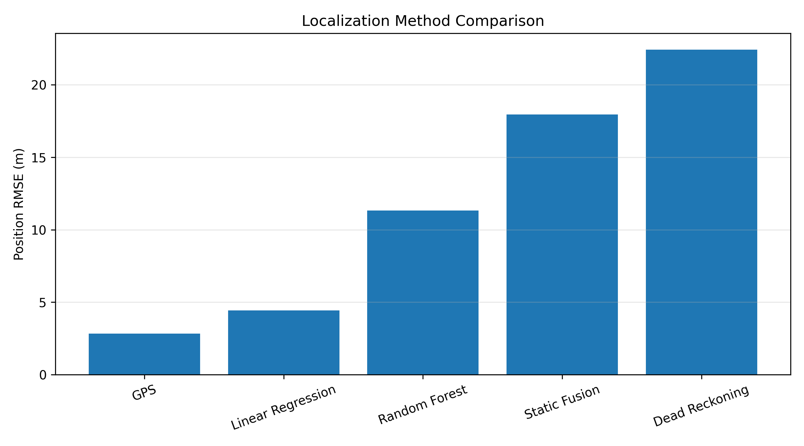

# Robot Sensor Localization

A Python project I built to understand robot localization and sensor fusion from the basics.

The goal of this project was to explore how GPS, IMU measurements, dead reckoning, Kalman filtering, and machine learning can be used to estimate a robot's position. I built each part step by step and compared how the different localization methods behave when sensor noise and drift are present.

## What I Implemented

- GPS measurement simulation with noise
- Dead reckoning and accumulated drift
- IMU acceleration simulation with noise and bias
- 1D Kalman filtering
- GPS + IMU sensor fusion
- 2D robot motion and localization
- Linear Regression for position estimation
- Random Forest Regression for position estimation
- RMSE-based comparison of localization methods

## Project Structure

```text
robot-sensor-localization/
│
├── ml/
│   └── position_estimator.py
│
├── plots/
│   └── localization_comparison.png
│
├── src/
│   ├── dead_reckoning.py
│   ├── gps_imu_fusion.py
│   ├── kalman_1d.py
│   ├── localization_2d.py
│   └── simulate_imu.py
│
├── requirements.txt
└── README.md
```

## Localization Comparison

For the final experiment, I trained the machine learning models on the first 80% of the simulated trajectory and tested them on the final 20%. This chronological split was used instead of randomly mixing samples so that the models were evaluated on a future, unseen section of the trajectory.

| Method | Position RMSE |
|---|---:|
| GPS | 2.82 m |
| Linear Regression | 4.43 m |
| Random Forest | 11.32 m |
| Static Sensor Fusion | 17.95 m |
| Dead Reckoning | 22.44 m |



## What I Learned

One of the main things I learned from this project is that sensor fusion does not automatically give a better estimate.

Dead reckoning gives a continuous position estimate, but even small velocity and heading errors accumulate over time and cause drift. GPS measurements are noisy, but the GPS error does not accumulate in the same way.

I also experimented with machine learning for localization. Linear Regression generalized better than Random Forest on the future section of this simulated trajectory. Random Forest performed poorly when the test data moved into regions that were not well represented by the training data.

The experiments helped me understand why localization systems need to consider sensor uncertainty instead of simply combining measurements with fixed weights.

## Kalman Filtering

I implemented a simple 1D Kalman filter to combine prediction and measurement information.

The Kalman gain changes how much the estimate trusts the measurement:

- Higher measurement uncertainty → lower Kalman gain
- Lower measurement uncertainty → higher Kalman gain

I also simulated changing GPS quality to see how measurement uncertainty affects the filter.

## IMU and Drift

I simulated acceleration measurements containing both random noise and a small constant bias.

Integrating acceleration produces velocity, and integrating velocity produces position. Because of this double integration, even a small accelerometer bias can produce significant position drift over time.

## Tools

- Python
- NumPy
- Pandas
- Matplotlib
- scikit-learn

## Limitations

This project uses synthetic sensor measurements rather than measurements from a physical robot.

The 2D sensor fusion implementation is intentionally simple and is not a full Extended Kalman Filter. The machine learning models were also trained and tested using sections of the same simulated trajectory, so their results should not be interpreted as performance on a real robot or completely unseen environments.

## Future Work

I would like to extend this project with:

- Extended Kalman Filter (EKF) localization
- Multiple training trajectories for better ML evaluation
- Real GPS and IMU datasets
- ROS 2 integration
- Gazebo simulation
- Testing on a physical mobile robot

## Why I Built This

I am currently learning robotics sensing and navigation, and I wanted to understand localization by implementing the concepts myself instead of only studying the equations.

Building the simulations helped me see how sensor noise, bias, drift, uncertainty, filtering, and machine learning affect a robot's estimate of where it is.